# Architecture de Video Analysis Agent

Version documentée : `0.1.0`.

## Vue d’ensemble

```mermaid
flowchart LR
    UI[Frontend React / Vite] -->|REST + polling| API[API FastAPI]
    CLI[CLI video-agent] --> PIPE
    MCP[Serveur MCP] --> PIPE
    API --> QUEUE[File locale en mémoire]
    QUEUE -->|ThreadPoolExecutor borné| PIPE[Pipeline Python]
    UPLOAD[Upload vidéo contrôlé] --> API

    PIPE --> INSPECT[Inspection FFprobe]
    INSPECT --> SEG[Segmentation PySceneDetect]
    SEG --> FRAMES[Extraction des frames]
    FRAMES --> MOTION[Grilles et composites]
    INSPECT --> AUDIO[Extraction et analyse audio]
    AUDIO --> TRANS[Transcription optionnelle]
    MOTION --> FUSION[Fusion audio-visuelle]
    TRANS --> FUSION
    FUSION --> PACK[Pack VLM et prompts]

    PACK --> MODE{Mode VLM}
    MODE -->|disabled| LOCAL[local_complete]
    MODE -->|manual, sans réseau| WAIT[awaiting_vlm]
    MODE -->|automatic + gemini explicite| PROVIDER[Provider VLM Gemini]
    WAIT --> IMPORT[Import JSON manuel]
    PROVIDER --> VALID[Validation stricte]
    IMPORT --> VALID
    VALID --> REPORT[Rapport complete / partial / failed]

    PIPE --> RUNS[outputs/runs/run_id]
    VALID --> RUNS
    REPORT --> RUNS
    API --> RUNS
    UI -->|manifest, scènes, artefacts, rapport| API
```

## Séparation des responsabilités

- `src/video_agent/` porte la logique métier : inspection, segmentation,
  extraction, audio, fusion, identité de run, validation et rapport.
- `scripts/` fournit les commandes spécialisées historiques. Les points d’entrée
  installables les réutilisent au lieu de copier leur logique.
- `web_api.py` valide les entrées HTTP, sécurise les artefacts et délègue au
  pipeline.
- `job_manager.py` gère une file locale bornée et la progression en mémoire.
- `frontend/` affiche les données retournées par l’API. Il ne recalcule ni statut,
  ni validation, ni résultat métier.
- `evaluation.py` reste séparé du pipeline de production et compare un run à des
  annotations versionnées.

## Identité d’un run

Le `run_id` est le SHA-256 d’une représentation JSON canonique contenant :

- le SHA-256 du contenu vidéo ;
- la configuration normalisée du pipeline ;
- le mode et le provider VLM ;
- les versions des schémas ;
- les empreintes des sources de prompts utilisées ;
- les paramètres importants de segmentation, audio, transcription et rapport.

Le nom ou le chemin du fichier ne participe pas seul à l’identité. Deux fichiers
homonymes de contenus différents produisent donc deux espaces indépendants sous
`outputs/runs/<run_id>/`.

## Checkpoints

Chaque checkpoint JSON enregistre l’étape, la configuration, la version de schéma,
la date et les empreintes des entrées et sorties. Une étape n’est reprise que si :

1. toutes ses sorties existent ;
2. leurs SHA-256 correspondent ;
3. les clés JSON minimales attendues sont présentes ;
4. les entrées, le schéma et la configuration sont inchangés.

Une sortie supprimée, modifiée ou corrompue invalide ce checkpoint et les étapes
dépendantes.

## Statuts du pipeline

| Statut | Signification |
|---|---|
| `complete` | tous les segments VLM attendus sont présents et valides |
| `partial` | au moins un résultat est exploitable, mais certains manquent ou sont invalides |
| `failed` | aucun résultat VLM exploitable ou échec du pipeline |
| `awaiting_vlm` | packs manuels prêts, résultats VLM encore attendus |
| `local_complete` | traitements locaux terminés avec VLM désactivé |

Les jobs HTTP ont leur propre cycle `queued`, `running`, `completed`, `failed` ou
`cancelled`. Un job `completed` expose ensuite le statut métier du pipeline.

## Mode sans réseau

`manual` et `disabled` n’initialisent pas le provider Gemini et ne demandent
aucune clé API. `manual` prépare les packs à analyser hors pipeline ; `disabled`
termine après les traitements locaux. Le mode `automatic` exige
`provider=gemini` et l’extra Python `gemini`.

Les outils locaux peuvent avoir leurs propres comportements : FFmpeg doit être
installé sur la machine et faster-whisper peut télécharger un modèle au premier
usage. La démonstration désactive transcription et appels VLM afin de rester
entièrement locale et reproductible.

## Limites d’exécution

La file de jobs est en mémoire et ne survit pas au redémarrage. L’annulation
garantie concerne les jobs encore en attente ; un processus FFmpeg ou Whisper
déjà lancé n’est pas interrompu de force. Il n’existe pas encore de verrou
interprocessus pour deux exécutions simultanées du même `run_id`.
